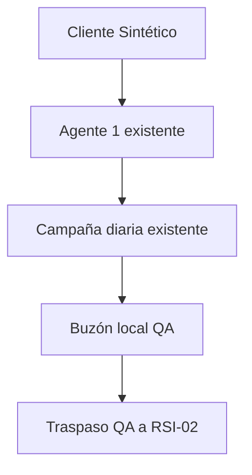

# QA aislado — Cliente Sintético

Responsable: Codex, autorizado por Ricardo el 18 octubre 2026.

## Plan y aceptación
Objetivo: reproducir Agente 1 → campaña → buzón QA → traspaso RSI-02, con recibos persistentes y sin proveedores reales. Reutiliza `createRsiExecutor`, `createDailyCampaign` y `createHandoffStore`; los adaptadores de almacenamiento y correo son exclusivos de QA. Presupuesto: USD0. Riesgo principal: confundir simulación con correo real; todos los informes indican transporte simulado, sin certificación Vercel/Gmail ni ventas. Rollback: retirar estos archivos y el paso QA del CI; producción no cambia.

Ejecutar `node scripts/qa/synthetic_campaign.mjs QA-20261018-0900` en un proceso aislado. La identidad y destinatario son fijos: `cliente@boltech.invalid`. No acepta destinatarios externos ni credenciales. Red bloqueada en el proceso y en sus hijos. Estado y recibos en `ops-output/synthetic-qa/<caso>/`. Solo una instancia por caso; bloqueo de proceso abandonado exige revisión, no se borra automáticamente.

El segundo proceso recupera el mismo recibo y no repite correo ni agente. `--fault-after-send` inyecta fallo después de persistir correo virtual: el ledger queda UNKNOWN y bloquea reintentos. Para una nueva prueba usar otro ID; no borrar un ledger incierto para forzar éxito.

La prueba conserva las exclusiones comerciales del cliente sintético. El adaptador QA admite exclusivamente una identidad fija, sin modificar `sdr_campaign` ni el relay productivo. El traspaso usa el contrato durable real, pero creación y aceptación las conduce el harness: no acredita consumo autónomo del agente 2. El código del Agente 1 se ejecuta con tablas locales; bloqueos de investigación real se conservan. No es integración con Apollo, Airtable, Redis, Gmail ni Vercel. Un correo virtual SENT en el ledger solo significa escritura en buzón QA.

Criterios: un mensaje virtual, un traspaso COMPLETED y cuatro recibos; reejecución sin duplicados; envío a otro destinatario imposible; red denegada incluso por HTTP directo; fallo incierto sin repetición. CI usa el workflow de validación existente, sin cron ni agente adicional.

## Resultado 18 octubre 2026
15 pruebas aprobadas: recorrido QA, recuperación en otro proceso, fallo tras persistir correo sin repetición, aislamiento de red/credenciales, campaña y exclusiones productivas. Caso `QA-20261018-0900-v2`: cuatro recibos, un mensaje virtual y cero correos reales. Evidencia en `docs/audits/SYNTHETIC_QA_ENVIRONMENT_20261018.json`. Primer intento abortó por contrato PATCH del adaptador QA; se conservó UNKNOWN, se corrigió el adaptador y se probó con caso nuevo. No es fallo productivo.
